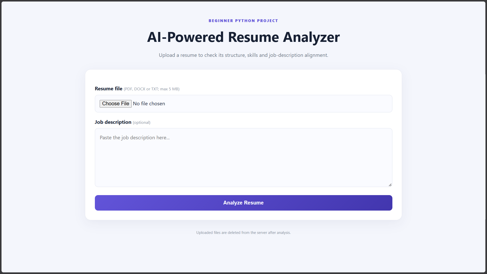
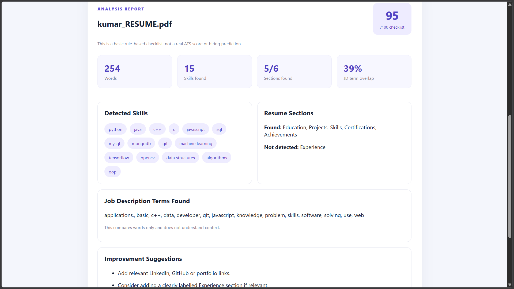
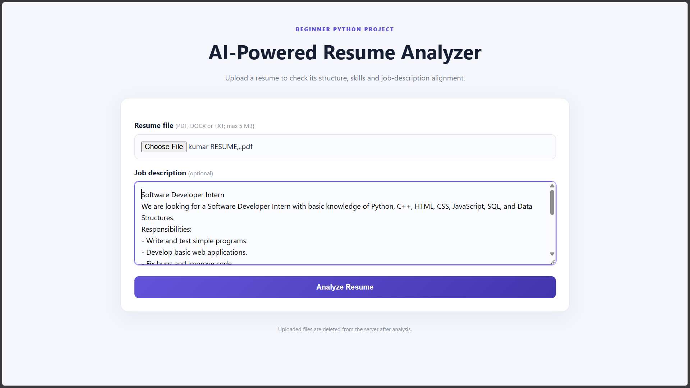
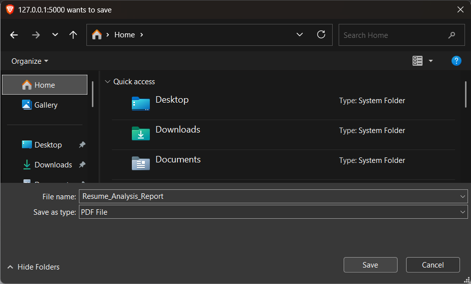

# AI-Powered Resume Analyzer

A beginner-friendly resume analysis web application built using Python and Flask. It helps users review resume completeness, identify technical skills, and compare resume keywords with a job description.

## Features

- Upload resumes in PDF, DOCX, and TXT formats.
- Extract readable text from uploaded resumes.
- Detect common technical skills.
- Identify important resume sections.
- Check email, phone number, and professional links.
- Compare resume keywords with a job description.
- Generate improvement suggestions.
- Display a resume analysis checklist score.
- Download a PDF analysis report.
- Automatically delete uploaded resume files after analysis.
- Responsive web interface.

## Technologies Used

- Python
- Flask
- HTML
- CSS
- PyPDF
- python-docx
- ReportLab

## Project Structure

```text
AI-Powered-Resume-Analyzer/
├── app.py
├── analyzer.py
├── requirements.txt
├── README.md
├── templates/
│   └── index.html
└── static/
    ├── style.css
    └── uploads/
```

## Installation and Setup

### Prerequisites

- Python 3.9 or newer
- pip

### Windows

1. Clone the repository:

```bash
git clone https://github.com/avarun46/AI-Powered-Resume-Analyzer.git
```

2. Navigate into the project:

```bash
cd AI-Powered-Resume-Analyzer
```

3. Create a virtual environment:

```bash
python -m venv venv
```

4. Activate it:

```bash
venv\Scripts\activate
```

5. Install dependencies:

```bash
pip install -r requirements.txt
```

6. Run the application:

```bash
python app.py
```

7. Open your browser:

```text
http://127.0.0.1:5000
```

## How It Works

1. The user uploads a resume.
2. Flask processes the uploaded file.
3. Text is extracted from the resume.
4. The analyzer checks skills, sections, and contact information.
5. Optional job-description keyword overlap is calculated.
6. Results and improvement suggestions are displayed.
7. The user can download a PDF analysis report.

## Important Limitations

This project currently uses rule-based keyword matching and a basic completeness checklist. It does not use a trained AI model or commercial ATS engine.

The checklist score is not a real ATS score, hiring prediction, or guarantee of selection. Job-description matching is based on keyword overlap rather than semantic understanding.

## Future Improvements

- Add OCR support for scanned resumes.
- Implement semantic matching using NLP or embeddings.
- Add unit tests.
- Improve skill detection and analysis accuracy.
- Add secure authentication and cloud deployment.

## Author
## Screenshots

### Homepage


### Resume Analysis


### Job Description Matching


### PDF Report


**Varun A**

GitHub: https://github.com/avarun46

LinkedIn: https://www.linkedin.com/in/varun077/
